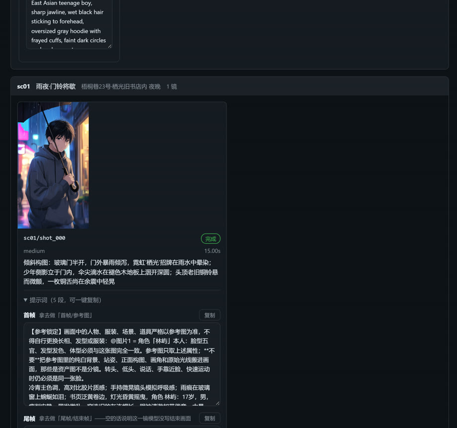
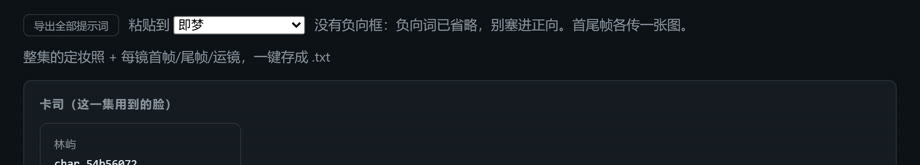

# ai-drama

[](https://github.com/ramaji114514/ai-drama/actions/workflows/tests.yml)

**中文** · [English](README.en.md)

**给一句话，拿到一套能直接粘进视频模型的提示词。**

你说「深夜加班回家，发现自家门锁被换过，猫眼从里面被贴住了」，它给你：

* **定妆照提示词** —— 这个角色长什么样（拿去生成角色参考图）
* **首帧提示词** —— 这一镜开头那一帧是什么样
* **尾帧提示词** —— 这一镜结束那一刻是什么样（首尾帧模型靠它控动作）
* **运镜提示词** —— 镜头怎么动、多快动完
* **负向提示词** —— 不要什么（人脸崩坏、水印、变脸、闪烁……）

每段都是能整段复制的成品，粘进可灵 / 即梦 / Sora / Veo / Runway 的框里就能出片。
页面上逐段复制，也能一键导出一整集的 `.txt`。

想要**直接出片**也行 —— 同一套东西接上视频模型就能从一句话走到一个 mp4，
但那条路是可选的，不接也能把提示词拿走。

---

## 三分钟上手

### 0. 你需要什么

* Python 3.10+（**不用装任何第三方库**，标准库跑完）
* FFmpeg（只有真的出片时才需要；只拿提示词不用装）
* 一个会写字的大模型 API key（下面用 DeepSeek，几分钱一整集）

想把它当系统命令用（不用每次 `cd` 到仓库里敲 `python run.py`）：

```bash
pipx install .        # 或者 pip install .
ai-drama doctor      # 装完就有这个命令了
```

装完之后 `ai-drama` 和 `python run.py` 完全等价；`config/` 与 `skills/` 会跟着包
一起装到 `<前缀>/share/ai-drama/`，想改默认值就改那里的（或者用 `AI_DRAMA_HOME` 指一份）。

### 1. 配一个大模型

仓库里有一份 `.env.example`，复制成 `.env` 再填两行：

```bash
cp .env.example .env
```

```bash
AI_DRAMA_TEXT=deepseek
AI_DRAMA_DEEPSEEK_API_KEY=sk-你的key
```

不填 key 也能跑：默认的 `dryrun` 是本地假数据，能看清整个流程长什么样，
但它写不出像样的句子 —— 要真东西就得接一个模型。

> **key 是你自己的，也只待在你机器上。**
> 仓库里没有任何 key，上面的 `sk-你的key` 是占位符；填好的 `.env` 被 `.gitignore`
> 挡住，不会进版本库。作者演示时用的那把 key 只是本地跑给我自己看的，不对外提供，
> 所以别指望 clone 下来就能直接用 —— 花几分钱配一把自己的，比等别人给稳。
> 这条线有测试盯着：`tests/test_no_secrets.py` 扫所有被 git 跟踪的文件，
> 一旦出现像真 key 的串就红。

### 2. 一句话 → 一套提示词

```bash
# 建一部剧（角色、风格、定妆照都跟着这部剧走，可以拍很多集）
python run.py project new "雨夜旧书店" --style "冷青主色调，高对比胶片质感，窄巷霓虹"

# 跑：剧本 + 分镜 + 定妆照 + 关键帧（不出片，只产提示词）
python run.py run "深夜加班回家，发现自家门锁被换过" \
  --project proj_xxxxxxxx --scenes 2 --shots 1 --stages script,storyboard,frames
```

跑完会打印产物在哪，`episode.json` 里就是全部台词和分镜。

### 3. 打开页面，复制提示词

```bash
python run.py web
```

浏览器打开 <http://127.0.0.1:8765>，点左侧任意一条 run，进「分镜」页：



每一镜下面有 **5 段提示词**，每段右边一个「复制」；顶部一个
**「导出全部提示词」**，把整集的定妆照 + 每镜首帧/尾帧/运镜/负向打包成一个 `.txt`。

提示词框**可以直接改**：改完点「保存」，它会写回 `episode.json` 和库；再点这一镜上的
**「重跑这一镜」**，就用新提示词重出这一镜的关键帧（只跑这一镜，不重跑整集）。
其余平台那份文本是裁过的，只读 —— 要改就切回「通用」改完再切。

改动作、改台词、改景别、改结束画面，不用去翻 `episode.json`：每一镜都有一个
**「改分镜原文」**，保存后它会用本地骨架把首帧/尾帧/运镜/负向**重拼一遍**，
并把时长按新台词重算。台词是时长的硬下限 —— 加一句话，这一镜就会变长。

侧栏顶上是一个搜索框：run 多了以后，搜剧名、想法里的一个词、`run_id` 的尾巴都能用，项目列表一起过滤（命中数会变成 `3/5`）。

右上角有个 **EN / 中文** 按钮：点一下界面就是英文的，下次打开还是英文（也可以直接 `?lang=en`）。翻的只有界面：提示词、台词、剧本 JSON 一个字都不动 —— 它们是要粘到别的工具里去的内容。

页面只绑本机，也不会替你建新 run、不会花钱：写入口只有"改提示词"、"改分镜原文"
和"重跑这一镜"三个。出镜人不许在页面上改：它牵连参考图和身份锁定，点错一次就会
静默换掉整镜的脸。

> 不想开网页、想让**脚本或 agent** 直接拿？`python run.py prompts --idea "一句话" --json out.json`
> 一步拿到同样的东西。想让自己常用的 agent 会主动调这个工具，装一下
> [`agent/SKILL.md`](agent/SKILL.md) —— 都写在下面的[「给脚本和 agent 用」](#给脚本和-agent-用)里。

---

## 提示词长什么样

《雨夜旧书店》第 1 镜，真实输出（节选）：

**首帧**

> 【参考锁定】画面中的人物、服装、场景、道具严格以参考图为准，不得自行更换长相、发型或服装
> 冷青主色调，高对比胶片质感；雨痕在玻璃窗上蜿蜒如泪；书页泛黄卷边，灯光昏黄摇曳
> 角色 林屿：17 岁，男，瘦削安静，黑色短发贴着额头，灰色连帽卫衣

**尾帧**（和首帧不同：写的是这一镜**结束**那一刻）

> 铜铃停在半空，门缝里伸进来的伞尖滴着水，林屿的手已经按在柜台边缘

**运镜**

> 镜头缓慢推近，越过门框停在林屿的侧脸上，15 秒内匀速完成，不加速也不放慢

**负向**

> 多余的手指, 畸形的手, 五官错位, 文字, 水印, 字幕, 过曝, 塑料皮肤……
> 变脸, 闪烁, 跳帧, 动作僵住, 鬼影

五段各有骨架。这些骨架是从社区在用的模板里挑出来的，只留了能说清"为什么"的部分：

| 段 | 骨架（按这个顺序写） | 为什么这么排 |
|---|---|---|
| 定妆照 | 长相 → 正面胸像 / 平视 / 中性表情看镜头 → 纯色浅灰背景、无道具无遮挡 → 均匀柔光、脸上没有强对比阴影 → 85mm 浅景深 → 画风 | 它不是海报，是参考图。好看但逆光侧脸的图，拿去锁脸时什么也锁不住 |
| 首帧 | 角色（逐字）→ 动作 → 景别 → 焦段/景深/光比 → 机位高度 → 人数 → 风格 | 风格放最后；放前面会和"这个人长什么样"抢权重 |
| 尾帧 | 角色 → 「同一镜头的最后一帧」+ 结束画面 → 景别 → 焦段 → 机位 → 「画面是一帧定格瞬间，边缘清晰，没有运动模糊」→ 人数 | 参考图带运动模糊，图生视频会跟着糊 |
| 运镜 | 怎么拍（只一个）→「N 秒内匀速完成，不加速也不放慢」→ 谁做了什么 → 最后停在哪儿 | 运镜写句尾，可灵会当成"可选的补充"，画面自己横过去 |
| 负向 | 解剖 + 风格塌陷 + 版面 + 画质（视频那条把解剖换成时间维度的事故） | 一组词管一件事。混着写，模型挑三条落实，剩下全丢 |

几个容易翻车的细节，这里都已经按字面处理了：

| 容易翻车 | 这里怎么处理 |
| --- | --- |
| 首帧和视频用同一句话，等于没说 | 首帧管"画面"，运镜管"变化"，分开写 |
| 尾帧从"动作"推不出来 | 让剧本模型单独写 `end_action`，否则提示词会空 |
| "不要水印"写进正向词，反而出水印 | 一律进独立的负向词 |
| 一镜 15 秒，模型两秒演完 | 运镜里写明"15 秒内匀速完成" |
| 运镜句写在最后，被当成"可选项" | 运镜放最前面，先说怎么拍，再说人做什么 |
| 有台词，画面里的人却闭着嘴 | 自动补一句"人物开口说话，口型与台词同步" |
| 只说"林溪站在门口"，模型顺手再画两个人 | 写死人数："画面中只有 林溪"；空镜写"画面中没有人" |
| 只写"中景"，画面又平又亮 | 补焦段和光比："35mm，中景深，侧逆光" |
| 一镜塞两个运镜（"推近后横移"） | 体检会点名，模型只会二选一 |

### 短版是默认，详细版一个环境变量

平台实测：中文提示词 30–80 字最稳，200 字开始"顾此失彼"—— 每条要求都在争夺
注意力，最后哪条都没落实。所以首帧的画面描述默认压在 200 字以内（必带的参考锁定段另算）：只留
"谁 + 做什么 + 怎么拍"，风格压到最后一句。

要详细版（长描述、长风格、不精简）：

```bash
AI_DRAMA_PROMPT_DETAIL=full
```

### 写完自己检查一遍

提示词拼完，`stage02` 会做一次本地体检（不联网、不花钱）：没写 `end_action`、
运镜做不完、有台词没开口、一镜多个运镜、没有负向词……都会进阶段报告的
"提示词体检 N 条提醒"。它不拦着你出片，只是把"会在成片里看出来"的问题提前说。

**同一份结果也在网页上**：每镜一个角标——通过就写"体检通过"，有问题写"体检 N 条"，
点开是"哪一条 + 为什么"。以前它只活在命令行输出里，跑到页面上就看不见了。

---

## 一镜两个人：那张参考图该给谁

主力图像模型单次**只吃 1 张参考图**，视频接着也只吃 1 张首帧。所以只要一镜里
有两个人，就必然有一个人的脸只能靠文字描述 —— 这不是我们挑的，是接口事实。

那一张给谁？按"谁的脸被看得最久"排：

1. **这一镜说话的人**优先 —— 台词的承载者，镜头停在他脸上的时间最长；
2. 都沉默时看**全片出镜次数**，出现得越多，锁脸的收益越大；
3. 还平就按分镜里的声明顺序。

没拿到图的人，提示词里会多一段 `【无参考图】`：写明"按文字描述生成，
不要把 @图片1 的脸安到 ta 身上"。这比沉默好 —— 沉默的结果是两个人长成同一张脸。

### 要两张脸都锁住，就拆镜

```bash
python run.py split run_xxxxxxxx --shot sc01/shot_000
```

它给的是电影里的老办法：**单人特写 → 反打单人 → 双人全景**。

```
== sc01/shot_000 · close · 15.0s · 出镜 猫（灰灰）、林溪
   参考图给了 林溪（单镜最多 1 张），其余 1 人按文字描述生成
   锁脸 林溪：这一镜的台词是 ta 说的
1. [close] 雨滴顺着玻璃滑落，灰猫端坐在窗台正中，绿眼凝视窗… （林溪；要参考图）
2. [close] 林溪的脸停在离猫半臂距离，猫仍纹丝不动盯着窗外… （猫（灰灰）；要参考图）
3. [wide] 林溪、猫（灰灰）在同一个空间里，交代位置关系 （两人；不用参考图）
```

第三段为什么是全景：**脸在画面里越小，模型越不需要参考图**。全景里两个人各占
一小块，靠服装和发型就能认人。这就是只有 1 张参考图还能拍两个人的办法。

`split` **只出方案，不改你的分镜** —— 拆镜要新建镜头、重排编号、决定每段用哪张图，
任何一步由脚本替你决定都可能把已经调好的戏搅乱。

---

## 想让整部多长，就说一个数

```bash
python run.py run "一句话" --scenes 2 --shots 2 --target 40
```

目标 ÷ 镜数 = 每镜分到多少秒（这里 4 镜摊 40 秒 = 每镜 10 秒）。
只写了 `--target` 不写镜数，就按默认的 3 场 × 4 镜去摊。

有一件事它**不会**做：为了凑时长把台词剪短。台词读不完的镜头以台词为准，
报告里会明说差多少：

```
定稿 4 镜 / 总时长 52.4s / 定妆照 2 张（目标 40s，多 12.4s）
```

反过来，镜数多到每镜摊不到 2 秒时，它会直接说这个目标做不到，
而不是悄悄给你一条 48 秒的片子 —— 24 个镜头无论如何演不完 30 秒的戏。

---
## 粘到哪个平台，写法不一样

同一个镜头，可灵、即梦、Seedance、海螺、Runway 的输入框并不是同一套：有没有独立的负向框、
认不认尾帧图、单个框能放多少字，都不一样。页面右上角选一下要粘到哪儿，下面的提示词
就换成那个平台的写法：



| 平台 | 负向框 | 尾帧图 | 单个框上限 | 运镜怎么写 |
| --- | --- | --- | --- | --- |
| 通用 | 有 | 支持 | 4000 | 自然语言 |
| 可灵 | 有 | 支持 | 2500 | 自然语言，运镜放最前 |
| 即梦 | 无 | 支持 | 2000 | 自然语言 |
| Seedance（豆包） | 无 | 支持 | 2000 | 自然语言，素材写 `@图片1` |
| 海螺（MiniMax） | 无 | 支持 | 2000 | 方括号指令，如 `[Push in]` |
| Runway | 无 | 支持 | 2000 | 自然语言（英文更稳） |
| Veo | 有（500 字） | 支持 | 2000 | 自然语言（英文更稳） |

**定妆照也吃这套**，而且多一版：完整版（五条规格全在）+ 紧凑版（只留长相和拍法，
画风句整段删掉）。参考图模型看的是长相，风格句只会跟长相抢权重 ——
图框挤、或者出来的参考图"像海报不像人"时，换紧凑版试一次。选「通用」就只有完整版，
因为它不替你做减法。
| Sora | 无 | 只认首帧 | 2000 | 自然语言（长句更好） |

几条规矩：

- **没有负向框的平台，负向词整段省掉**，并在页面上写明原因 —— 别把它补进正向，
  正向里的每个名词都会被当成要画的东西。
- **只认首帧的平台**（Sora），尾帧那段话并进视频提示词，告诉你"演到哪儿为止"。
- **超长自动断在句末**，页面上标出"截过"。上限是查官方文档得到的，不是猜的。
- **英文平台**（Runway / Veo / Sora）**提示词本身还是中文**，页面会提示翻一下 ——
  骨架不替你做，因为那要再调一次模型、再花一次钱。

导出的 `.txt` 也跟着走：选了哪个平台，文件里就是那个平台要粘的几段。

---

## 分镜表导成 CSV，Excel 直接开

```bash
python run.py shots run_xxxxxxxx --format csv --out 分镜表.csv
```

一行一镜，列是制片看表要的顺序：场次、镜号、景别、时长、画面、结束画面、
台词、出镜，后面才是四段提示词和两段负向词。台词里的逗号引号换行都按
CSV 规则转义，所以不会错列；文件带 BOM，Windows 上双击不会乱码。

网页分镜页也有「导出分镜表 CSV」按钮，同一份内容，走浏览器下载。

---

## 它是怎么跑的


一句话进来，八个阶段依次产出，**每个阶段的产物都落在磁盘上**，
可以停下来看、可以改、可以只重跑某几步：

| 阶段 | 干什么 |
| --- | --- |
| `script` | 一句话 → 分场、分镜、台词、角色 |
| `storyboard` | 拼出四段提示词 + 负向词，定下每镜时长，出定妆照 |
| `frames` | 出关键帧（首帧图） |
| `video` | 出视频片段（可选） |
| `audio` | 配音（可选） |
| `lipsync` | 口型同步（可选） |
| `concat` | 拼接、烧字幕、出成片（可选） |
| `qc` | 成品自检：时长、黑帧、音画对齐（可选） |

只拿提示词，跑到 `storyboard` 就够了 —— 后面的全都可以不跑。

---

## 命令表

```bash
python run.py doctor                  # 环境自检：哪一步会用到哪个模型，key 配没配
python run.py providers               # 已注册的 provider 和它们的状态
python run.py web                     # 网页：分镜 / 时间轴 / 质检 / 成本 / 资产 / 成片
python run.py mcp                     # MCP 服务器（stdio），给 Claude Code 这类客户端挂
python run.py prompts --idea "一句话" --variants 3   # 一次出 3 个调度不同的版本挑一个
```

| 命令 | 干什么 |
| --- | --- |
| `project new <名字>` | 建一部剧（角色圣经 + 风格，跨集复用） |
| `run "<一句话>"` | 跑一条流水线 |
| `prompts --idea "<一句话>"` | 只产提示词，打成 JSON 给脚本/agent 用（`--variants N` 出多个版本） |
| `mcp` | MCP 服务器（stdio）：`write_prompts` / `lint_prompts` / `list_runs` |
| `resume <run_id>` | 断点续跑，只跑还没做的部分 |
| `status <run_id>` | 逐镜进度 |
| `shots <run_id>` | 导出分镜表（`--format md` / `json` / `csv`） |
| `split <run_id>` | 一镜两个人怎么办：拆镜方案（`--shot` 指定一镜，`--json` 机读） |
| `cost <run_id>` | 成本明细（按阶段 / 按 provider） |
| `assets <run_id>` | 资产台账；`--check` 对账 |
| `asset <asset_id>` | 一件资产的前因后果（血缘） |
| `qc <run_id>` | 质检报告（0 通过 / 2 不通过 / 3 没查成） |
| `models` | 模型目录：能力上限、支持哪些参考素材 |
| `skills` | 技能目录：某一环节实际会加载哪几篇 |
| `faces` | 定妆照多张并存时，谁的脸算准 |

常用参数：

```bash
python run.py run "一句话" \
  --scenes 2 --shots 1 \
  --aspect 9:16 \
  --stages script,storyboard \
  --budget 1.5
```

* `--scenes` / `--shots`：几场、每场几镜
* `--target`：整部想要多长（秒），均摊到每个镜头，例如 `--target 60`。
  台词比摊到的时长更长时**以台词为准**，报告里会写出差了多少
* `--aspect`：`9:16` 竖屏（默认）/ `16:9` / `1:1` / `4:5`
* `--stages`：只跑这几步；只拿提示词就写 `script,storyboard,frames`
* `--budget`：预算上限（美元），超了当场停
* `--force`：忽略缓存全部重跑

---

## 给脚本和 agent 用

网页是给人看的。要让**别的程序**拿提示词，有四条路，按省事程度排：

### 一、命令行直接吐 JSON

```bash
python run.py prompts --idea "深夜便利店，店员发现每个客人都买同一件东西" \
  --scenes 2 --shots 2 --json out.json

# 不给 --json 就打到 stdout，进度写 stderr，管道不会脏
python run.py prompts --idea "一句话" | jq '.scenes[0].shots[0].image_prompt'
```

它只跑"剧本 + 分镜"两步，**一台图模型都不碰**，所以整集的花费只来自文本模型，
一集通常不到一分钱。字段：

| 字段 | 是什么 | 粘到哪 |
| --- | --- | --- |
| `characters[].anchor_prompt` | 定妆照 | 「角色参考图」/ 图生图 |
| `scenes[].shots[].image_prompt` | 首帧 | 「首帧」图片框 |
| `scenes[].shots[].last_frame` | 尾帧 | 「尾帧」图片框 |
| `scenes[].shots[].video_prompt` | 运镜 + 动作 + 时长 | 视频提示词框 |
| `negative_prompt` / `video_negative` | 两条负向词 | 负向提示词框（没有就跳过） |

加 `--dialect` 就按某家网页端的框先整理一遍再给你：

```bash
python run.py prompts --idea "一句话" --dialect jimeng --json out.json
# 可选：generic（默认）/ kling / jimeng / seedance
```

这时每镜会多出 `fields`（这家平台**实际有的**那几个框，超长的已按字数上限截断）
和 `dropped`（这家没有的字段，连同"为什么省掉"一起写明）。原来的五段照样留着
—— 截断是有损的，想改还得有原文。

### 二、让 agent 直接调（MCP 服务器）

不想让 agent 去 shell 里拼命令，就把它挂成 MCP 服务器 —— Claude Code、Cursor
这类支持 MCP 的客户端会自己发现这三个工具：

```json
{
  "mcpServers": {
    "ai-drama": { "command": "python", "args": ["run.py", "mcp"], "cwd": "/你的/ai-drama" }
  }
}
```

| 工具 | 干什么 |
| --- | --- |
| `write_prompts` | 一句话 → 定妆照/首帧/尾帧/运镜/负向词（只调文本模型，不出图） |
| `lint_prompts` | 体检一条 run：太长、运镜太快、有台词没开口、缺负向词 |
| `list_runs` | 最近的 run：标题、状态、总时长 |

stdio 传输，一行一个 JSON-RPC；日志全走 stderr，所以客户端永远只看到协议本身。
零依赖手写：MCP 这一层只用得上三个方法（initialize、tools/list、tools/call），
不值得为此装一套 SDK。

想要几个版本挑一个，加 `--variants`：

```bash
python run.py prompts --idea "一句话" --variants 3 --json out.json
# 得到 out.v1.json / out.v2.json / out.v3.json，stderr 上还有一张对照表：
# 变体  镜数  总时长  片名
#   1     4    60.0s  雨夜旧书店  (run_...)
```

变体不是"重跑一遍碰运气"：每个变体会拿到一句**换开场、换结尾**的额外要求，
否则同一个模型对同一个想法会给出高度相似的分镜。

### 三、让 agent 自己去调（skill 入口）

仓库里带了一份 agent 说明：[`agent/SKILL.md`](agent/SKILL.md)。它写清了什么时候该
用这个工具、怎么调、JSON 长什么样、粘提示词时最容易翻车的三件事。放进你用的
agent 的技能目录，它就会自己判断该不该调：

```bash
# Claude Code / 大多数本地 agent
mkdir -p ~/.claude/skills/ai-drama-prompts
cp agent/SKILL.md ~/.claude/skills/ai-drama-prompts/

# 用 .agents/skills 约定的一类工具（DSH、部分 CLI agent）
mkdir -p ~/.agents/skills/ai-drama-prompts
cp agent/SKILL.md ~/.agents/skills/ai-drama-prompts/
```

只在某个项目里用，就放到那个项目的 `.claude/skills/` 或 `.agents/skills/` 下。
没有技能目录的 agent（比如直接对话的），把 `agent/SKILL.md` 的内容贴进它的
系统提示或项目说明里，效果一样。

装好之后你可以这样说：

> 帮我写一个 30 秒的悬疑短剧分镜，要能直接粘进即梦的提示词。

agent 会跑 `python run.py prompts`，把拿到的首帧/尾帧/运镜分开给你，而不是
把一整段文字糊在一起。

### 四、网页上复制

最笨也最直观的一条：`python run.py web` 打开分镜页，每段提示词后面都有「复制」，
顶上还有「导出全部提示词」把整集存成 `.txt`。适合手动挑几镜去出。

---

## 改一句话，不用重跑整集

改台词、改提示词、改某个镜头的时长，都是同一条路：

```bash
# 1. 打开这一集的 runs/<run_id>/episode.json，改你要改的那句
# 2. 读回库里，只重跑受影响的阶段
python run.py resume <run_id> --from-json --stages storyboard,frames
```

已经生成的关键帧和视频不会重做（除非加 `--force`），花过的钱也不会再花一遍。

---

## 还能真的出片（可选）

默认的 `dryrun` 是**本地假渲染**：能跑通全流程、能看到成品长什么样，
但画面是占位图、语音是合成的提示音。它存在的意义是让你在花钱之前
把流程和提示词都调好。

要真出片，把对应的形态换成真厂商：

```bash
AI_DRAMA_IMAGE=dashscope
AI_DRAMA_VIDEO=dashscope
AI_DRAMA_AUDIO=dashscope
AI_DRAMA_DASHSCOPE_API_KEY=sk-你的key
```

出片时有几个已经处理好的麻烦事：

* **一镜 15 秒**，模型单次只能出 5 秒时，会自动拆成多段，并**用上一段的最后一帧**
  接着拍 —— 不是每段都从同一张图重来一遍。
* **字幕**烧进画面，同时也单独写一份 `.srt`。
* **口型同步**是独立一步，成片不带原声、时长和输入严格一致。
* **质检**三态：通过 / 不通过 / 没查成。**"没查成"不算通过** ——
  缺个工具就让整批片子带着未知问题交付，是更糟的结果。

---

## 账单：真花的钱和"编出来的钱"分两栏


`dryrun` 的价格表是编的（"假装这张图值 3 美分"），一分钱没出门。
所以成本页把它们分开念：**实际花费**是真扣的，**占位估算**单独一行并标
`虚拟`。混成一个数，只产提示词的人会以为自己被扣了钱。

预算闸门（`--budget`）照旧算全部，超了立刻停 —— 但报表分得清。

---

## 接自己的模型

八种形态，各管一段，全程不写厂商名：

| 形态 | 环境变量 | 现在有谁 |
| --- | --- | --- |
| 写本子 | `AI_DRAMA_TEXT` | `deepseek`、`dashscope`、`dryrun` |
| 出图 | `AI_DRAMA_IMAGE` | `dashscope`、`dryrun` |
| 定妆照 | `AI_DRAMA_T2I` | `dashscope`、`dryrun` |
| 出视频 | `AI_DRAMA_VIDEO` | `dashscope`、`aihubmix`、`dryrun` |
| 配音 | `AI_DRAMA_AUDIO` | `dashscope`、`dryrun` |
| 口型 | `AI_DRAMA_LIPSYNC` | `dashscope`、`dryrun` |
| 看画面 | `AI_DRAMA_VISION` | `dashscope`、`dryrun` |
| 音效 | `AI_DRAMA_SFX` | 只有 `dryrun` |

改一行环境变量就换一家；换一家不用改任何阶段代码。
`python run.py doctor` 会告诉你每个环节实际会用谁、key 配没配。

接一家新厂商要写多少：见 [docs/adding-a-provider.md](docs/adding-a-provider.md)。
架构和数据流：见 [docs/architecture.md](docs/architecture.md)。

---

## 多集：角色要跨集一致

```bash
# 第 1 集
python run.py run "雨夜，外卖员把最后一单送到一栋没有门牌的老楼" --project proj_xxxxxxxx

# 第 2 集：角色和定妆照直接用第 1 集的，脸不会换
python run.py run "第二天，同一个外卖员又来了" --project proj_xxxxxxxx
```

角色圣经（`projects/<project_id>/project.json`）里存的是每个角色的
描述、定妆照提示词、音色。同一部剧的第 N 集读的是同一份 ——
这是"三集之后观众还能认出是同一个人"的唯一办法。

---

## 目录

```
ai_drama/
├── core/        状态机、成本记账、路径约定、字幕、音色、媒体工具
├── providers/   各种模型厂商的适配器（dryrun / dashscope / deepseek / aihubmix）
├── stages/      八个阶段，每阶段一个文件
├── web/         网页查看器 + 改提示词 / 重跑单镜（标准库 http.server + 原生 JS，零构建）
└── skills/      提示词写法这类"会变的知识"，可单独改
```

```
config/     模型目录、质检规则
docs/       架构 / 接厂商 / 拍多集
runs/       每条 run 的产物（不进版本库）
projects/   角色圣经（不进版本库）
agent/      给 agent 的调用说明（SKILL.md）
```

---

## 测试

```bash
python -m pytest
```

全部离线，不碰网络、不花钱。`--strict-markers`；带 `ffmpeg` 标记的用例
需要本机装了 FFmpeg。

只验提示词那部分（不需要 FFmpeg）：

```bash
python -m pytest -m "not ffmpeg"
python tools/doc_audit.py     # 文档里写的命令/路径是不是真的存在
```

CI 上跑的是两套（见 `.github/workflows/tests.yml`）：
**不装 ffmpeg 的离线套件**（py3.10 与 py3.12 各一遍 —— 只拿提示词的人本来就不该
被 ffmpeg 拦住），以及**装了 ffmpeg 的完整套件**（真拼片、真烧字幕）。

---

## 许可

MIT，见 [LICENSE](LICENSE)。
