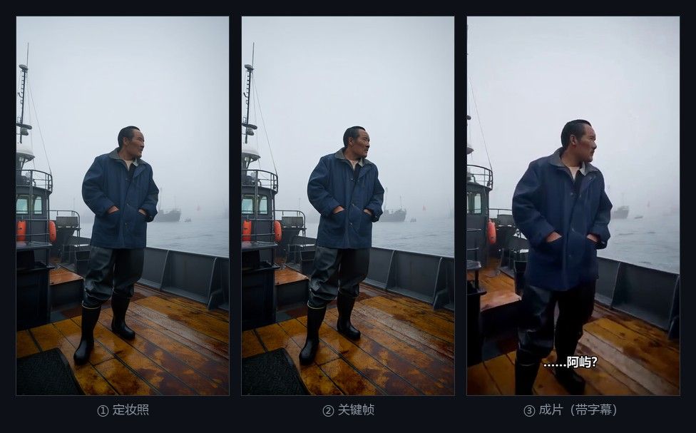
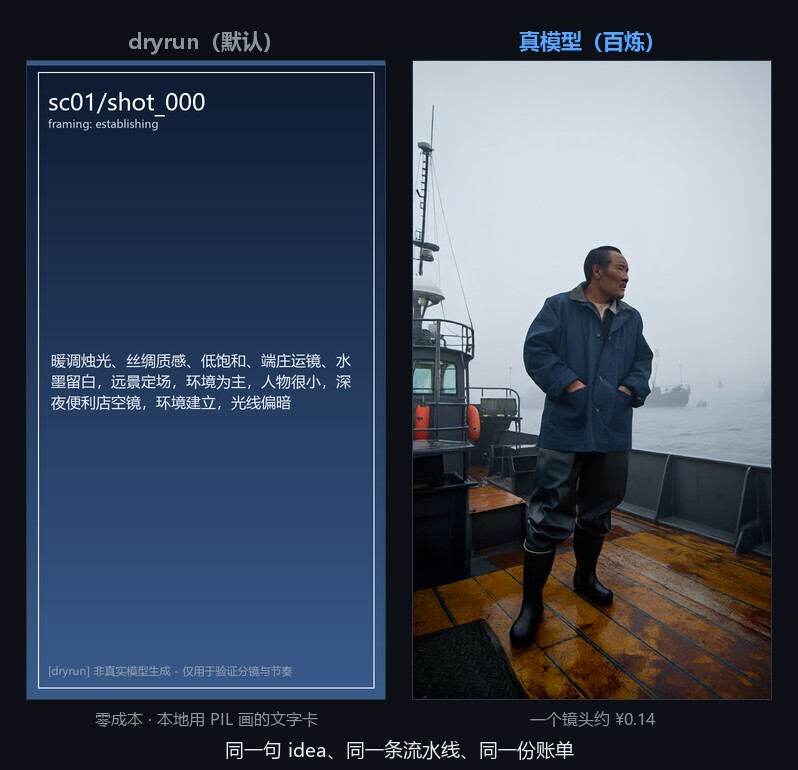
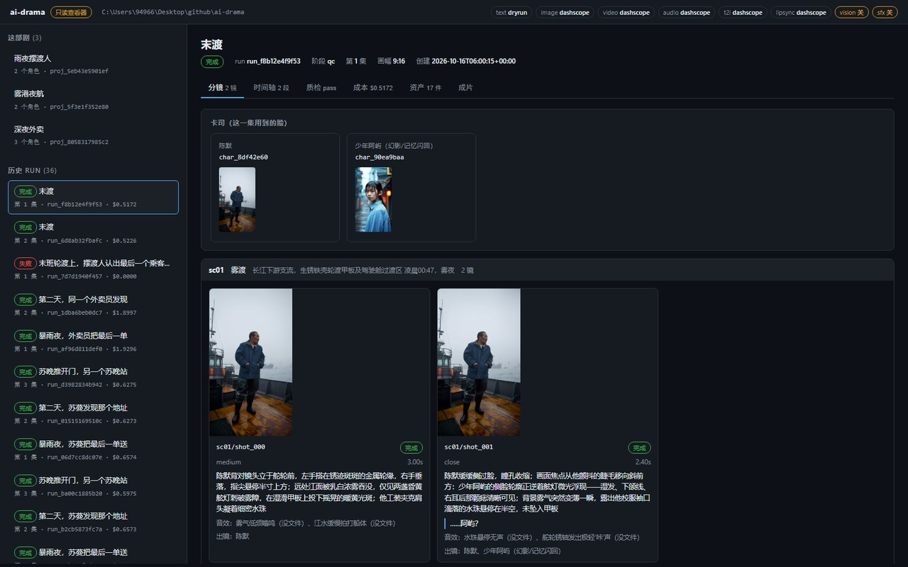
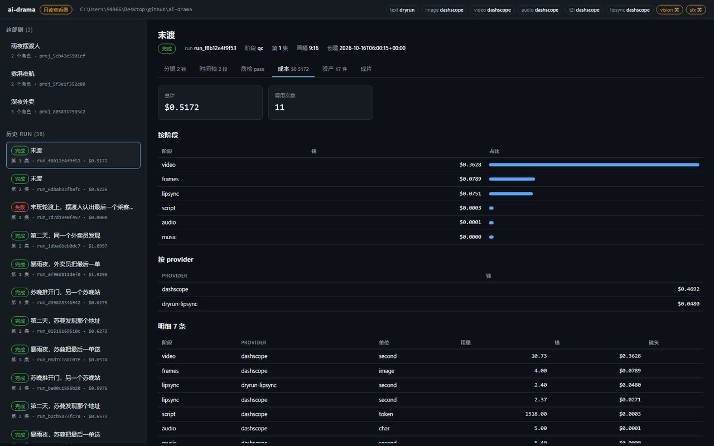
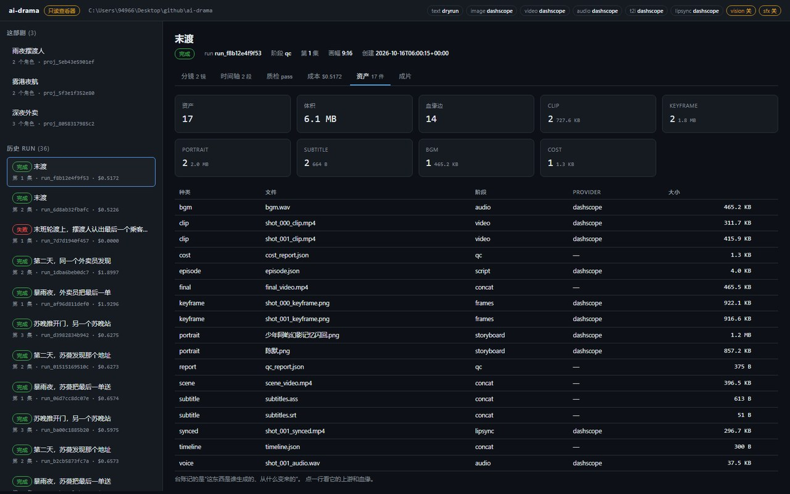
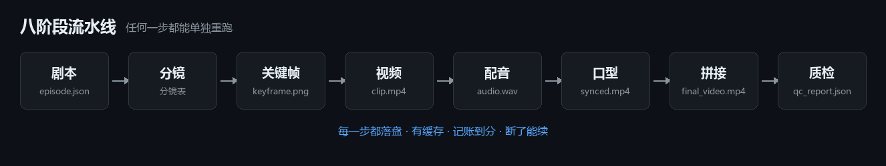

# ai-drama



**给一句话，出一部竖屏短剧。**

你说「深夜加班回家，发现自家门锁被换过，猫眼从里面被贴住了」。它跑完八步 ——
写剧本、拆分镜、画关键帧、生成视频、配音、对口型、拼接、质检 —— 最后交给你一个
能播的 `final_video.mp4`（竖屏、带音轨、带字幕），和一份精确到每个镜头的成本账单。

```bash
# 零 API key、零配置，直接跑通整条流水线
python run.py run --idea "深夜加班回家，发现自家门锁被换过，猫眼从里面被贴住了"
```

开头那张图是一次**真跑**的三步。第 ① 张和第 ③ 张是同一张脸 —— 这不是随手就能做到的：
角色跨镜头、跨集复用，否则第 2 集就换人了，而**报告里一切正常**。

三句话说清它是什么：

| 你可能想知道 | 答案 |
|---|---|
| **要 API key 吗** | 不用。默认是本地假渲染，零成本先把整条流程跑通、把账单跑准 |
| **要花多少钱** | 接上真模型后，一集 2 个镜头约 **$0.52**（≈ ¥3.5），按阶段拆得清清楚楚 |
| **会绑死一家吗** | 不会。换模型只改 `.env` 一行 —— 阶段代码里**没有厂商名** |

> 设计取向一句话：**厂商会换，流水线不该改。**

---

## 目录

- [这是什么 / 不是什么](#这是什么--不是什么)
- [三十秒跑起来](#三十秒跑起来)
- [它跑出来是什么样](#它跑出来是什么样)
- [拍多集：角色要跨集一致](#拍多集角色要跨集一致)
- [完整命令表](#完整命令表)
- [架构](#架构)
- [换厂商：只改一行](#换厂商只改一行)
- [骨架 vs skills](#骨架-vs-skills按会不会变切)
- [与同类项目的差别](#与同类项目的差别)
- [测试](#测试)
- [路线图](#路线图)

---

## 这是什么 / 不是什么

**是**：一条能跑通的八阶段流水线。每个阶段独立、可重跑、有落盘、
有缓存、有成本记账、有断点续跑。创意层（提示词）和骨架层（流程）分离。

**不是**：一个"接上就能出片"的成品。默认的 `dryrun` provider 只是
**本地假渲染** —— 它证明流程是通的、账单是准的、断点是真的能续的，
但它画出来的不是电影。

想看到真画面，把任一 provider 换成真厂商即可（见下面「换厂商」一节）。

---

## 三十秒跑起来

### 环境要求

| 依赖 | 版本 | 说明 |
|---|---|---|
| Python | ≥ 3.10 | 只用了标准库 + Pillow |
| Pillow | 任意 | 画占位图。`pip install pillow` |
| ffmpeg | 任意 | 拼接、转码、混音、烧字幕。**必须在 PATH 里** |

可选：中文字体。Windows 用系统自带的 `msyh.ttc`，Linux/macOS 会自动找
`Noto Sans CJK` / `PingFang`。找不到字体不会崩，只是占位图上的字变成方块。

### 三条命令

```bash
pip install pillow

python run.py doctor      # 自检：python / ffmpeg / 字体 / provider 配置
python run.py run --idea "你的想法"
```

只想跑测试的话再装一个 pytest：`pip install pytest`（测试不需要 API key，
但需要 ffmpeg 的那几个用例会在没装时自动跳过）。

`doctor` 会打印每个 provider 的**实际生效值**（环境变量 → 用哪个），
以及数据库路径和 `skills/` 目录位置。

---

## 它跑出来是什么样

### 默认的假渲染长这样



默认那条命令跑出来的是左边这种**文字卡片**：景别、时长、台词都直接写在画面上。

它丑，但它**不是占位符** —— 它是可读的分镜可视化（画法见
`ai_drama/providers/dryrun.py`）。所以你能零成本先把节奏跑对、把 60 集的骨架
跑通、把账单算准，确认没问题再花钱。右边是接上真模型之后**同一个镜头**的样子。

### 看片子：`web`

产物都在 `runs/<id>/` 里，但"分镜长什么样、关键帧是哪张、字幕落在第几秒、
质检那几条**没查成**到底是什么"这种事，靠一个个打开文件是看不出来的：



```bash
python run.py web                 # 打开 http://127.0.0.1:8765
python run.py web --open          # 顺便把浏览器打开
python run.py web --port 9000 --root /path/to/project
```

一个页面，六个 tab：分镜 / 时间轴 / 质检 / 成本 / 资产（带血缘树）/ 成片。
地址栏直接指向某一集某一页，可以当链接发给人（`#/run/<id>/assets`）。

成本页 —— 每一笔钱都能追到是哪一步、哪个 provider、多少量：



资产页是一本**血缘台账**：一件东西是谁生成的、又被谁用了：



它是**只读的**，而且只做只读 —— 花钱的那条路仍然只有 CLI 的 `run` / `resume`
（带预算闸门、断点续跑、job_id 台账）。默认只绑 `127.0.0.1`，绑别的网卡要显式
`--allow-remote`。零依赖、零构建：`http.server` + 原生 JS，没有 npm。

---

## 拍多集：角色要跨集一致

一次 run 出一集。要拍一部 60 集的剧，就得让角色跨集保持一致 ——
否则第 2 集的脸就跟第 1 集不一样了，而**报告里一切正常**：

```bash
python run.py project new "深夜外卖" --style "冷色调，手持感"
# -> project_id = proj_xxxxxxxx

python run.py run --project proj_xxxxxxxx --idea "第1集：暴雨夜送到一栋没人的楼"
python run.py run --project proj_xxxxxxxx --idea "第2集：她在地下二层听见自己的名字"
# 第 2 集不会再生成苏蔓的定妆照 —— 直接用第 1 集那张图
```

第一集跑完，角色和定妆照就自动写进了 `projects/<id>/project.json`；
之后每一集都复用同一批文件。要改角色（换发型、改年龄、定音色），
直接改那个 json，或者 `python run.py project set <id> 苏蔓 --voice female_07`。

细节、边界和"为什么不是靠提示词锁住脸"写在
[docs/making-a-series.md](docs/making-a-series.md)。

---

## 完整命令表

| 命令 | 作用 |
|---|---|
| `doctor` | 环境自检 |
| `providers` | 列出已注册的 provider |
| `models` | 模型目录：能力上限、参考素材字段、默认模型 |
| `rules` | 当前生效的质检规则，以及它来自文件还是内置默认值 |
| `skills` | 技能目录；某一环节实际会加载哪几篇、常驻成本多少 |
| `faces <run_id>` | 谁的脸算准：定妆照多张并存时给出基准与冲突清单 |
| `project new/list/show/set` | 一部剧的**角色圣经**：角色与定妆照跨集复用 |
| `runs` | 历史 run 列表 |
| `run --idea "..."` | 跑一条完整流水线 |
| `resume <run_id>` | 断点续跑（只重跑未完成的） |
| `status <run_id>` | 逐镜进度（含已提交、还没拿回产物的未结算任务） |
| `shots <run_id> [--format md\|json]` | 导出分镜表 |
| `cost <run_id>` | 成本明细（按阶段/按 provider 汇总） |
| `qc <run_id> [--format text\|json]` | 质检报告（返回码 0=通过 2=不通过 **3=没查成**） |
| `assets [run_id] [--kind K] [--check]` | 资产台账：这次 run 产出了什么、谁生成的（`--check` 和磁盘对账，返回码 **0=一致 2=对不上**） |
| `asset <asset_id> [--tree]` | 一件资产的前因后果：上游是什么、下游用在哪 |
| `web [--port 8765] [--allow-remote]` | 只读的本地查看器（分镜 / 时间轴 / 质检 / 成本 / 资产 / 成片） |

`run` 的常用参数：

```
--idea        一句话想法（必填）
--style       视觉风格
--scenes      场次数（默认 3）
--shots       每场镜头数（默认 4）
--stages      只跑指定阶段，逗号分隔：script,storyboard,frames,video,audio,lipsync,concat,qc
--budget      预算上限（美元），超了抛异常停止。0 = 不限
--concurrency 并发数（默认 3）
--force       忽略缓存全部重跑
--no-strict-qc  质检非 PASS 也照样把 run 标成 done（默认是严格模式）
--project     归到某部剧下：角色与定妆照跨集复用（见上面的「拍多集」）
--no-subtitles  不把字幕烧进画面（SRT 照样写出来，可外挂）
--aspect      画幅：9:16（默认，竖屏）/ 16:9 / 1:1 / 4:5，也可写 1280x720
```

---

## 架构

八步，顺序固定；每一步都能单独重跑：



目录结构：

```
ai-drama/
├── run.py                      入口
├── config/
│   ├── models.yaml             模型目录：能力上限 / 参考素材字段 / 单价
│   └── qc_rules.yaml           质检规则（数据不是代码，改这里不用改 Python）
├── ai_drama/
│   ├── cli.py                  命令行
│   ├── core/
│   │   ├── models.py           Shot / Scene / Episode / Character / Run / CostEntry
│   │   ├── cast.py             角色引用解析：id / 名字 / 别名 → 身份（纯函数）
│   │   ├── store.py            SQLite 落盘 + 成本记账 + 未结算任务台账
│   │   ├── assets.py           资产台账 + 血缘：谁生成的、由什么变来的
│   │   ├── pipeline.py         八阶段编排 + 质检闸门
│   │   ├── context.py          StageContext + Ledger（成本闸门）
│   │   ├── paths.py            产物路径约定（dryrun 与真厂商落在同一处）
│   │   ├── media.py            ffmpeg 封装 + 单段时长拆分 + 字幕（SRT/ASS）
│   │   ├── catalog.py          模型目录：caps / ref_fields / 默认模型
│   │   ├── miniyaml.py         零依赖 YAML 子集（配置需要能写注释）
│   │   ├── qc.py               确定性质检 + 三态判定（pass/fail/**unchecked**）
│   │   ├── identity.py         参考锁定 + 一致性判定解析（纯函数）
│   │   ├── faces.py            多张脸谁当准（纯函数，可离线测）
│   │   ├── vision_qc.py        要**看图**的质检（默认关，见设计决定 14）
│   │   ├── skills.py           技能两级披露：预筛 → 选择 → 注入
│   │   └── project.py          角色圣经：跨集复用角色 / 定妆照 / 音色
│   ├── providers/
│   │   ├── base.py             八个 ABC + 能力声明 + 重试 + 定价表  ← 全项目最重要
│   │   ├── registry.py         注册表 + build_bundle() 依赖注入点
│   │   ├── dryrun.py           本地假渲染（零成本跑通全流程）
│   │   └── _template.py        接真厂商时照这个补
│   └── stages/
│       ├── stage01_script.py      想法 → 分场分镜表
│       ├── stage02_storyboard.py  定妆照 + 参考锁定 + 提示词 + 时长核算
│       ├── stage03_frames.py      关键帧（并发）
│       ├── stage04_video.py       镜头视频（并发 + 拆段 + 独立重试）
│       ├── stage05_audio.py       配音 + BGM
│       ├── stage06_lipsync.py     口型同步（只做有台词的镜头）
│       ├── stage07_concat.py      拼接 + 混音 + 烧字幕（先写时间轴）
│       └── stage08_qc.py          质检（确定性 + 可选的画面校验）
│   └── web/                    只读查看器（stdlib + 原生 JS，零构建）
│       ├── api.py              store + 磁盘 → 可 json 的字典（纯函数，离线可测）
│       ├── app.py              路由 / Range / 只读守卫（绑非回环要显式开关）
│       └── static/             index.html + app.js + style.css（改完刷新就是新的）
├── skills/                     创意层：提示词与判断标准（见 skills/README.md）
├── docs/
│   ├── architecture.md         设计决定与硬约束
│   └── making-a-series.md      拍 60 集：角色圣经怎么用
│   └── adding-a-provider.md    换模型的那几十行
├── tests/                      测试
├── projects/<project_id>/      跨集共用的东西（一部 60 集的片子只有一个）
│   ├── project.json            角色圣经 —— 人手可改，改完下一集生效
│   └── portraits/<角色名>.png   定妆照：复用同一张是脸不漂的唯一硬保证
└── runs/<run_id>/              每次运行的产物
    ├── episode.json            分镜定稿 —— 人手可改，改完直接 resume
    ├── character_<名>.png      定妆照
    ├── timeline.json           每个镜头在成片里的起止秒数（字幕与对齐共用）
    ├── subtitles.srt           字幕交付物（标准 SRT，可直接上传平台）
    ├── subtitles.ass           烧录用的 ASS（带样式，字号是真实像素）
    ├── qc_report.json          质检报告
    ├── scenes/sc01/
    │   ├── shot_000_keyframe.png
    │   ├── shot_000_clip.mp4
    │   ├── shot_000_audio.wav
    │   └── scene_video.mp4
    ├── final_video.mp4
    └── cost_report.json
```

### 二十一条设计决定（以及为什么）

**1. `submit + poll`，而不是一个阻塞的 `generate()`**
视频模型动辄排队几分钟。阻塞式接口没法做并发、没法做超时、
更没法在进程重启后恢复。提交拿 id、轮询查状态，是唯一正确的形态。
（见 `ai_drama/providers/base.py` 的 `VideoProvider`。）

**2. 每次调用都返回 `(返回值, usage)`**
provider 自己**不记账**，它只报告"我花了多少"，由 `Store` 统一落盘。
这样成本统计永远和实际调用一一对应，不会漏记也不会重记。

**3. 失败就可见，绝不静默降级**
参考实现里最常见的反模式是：出错时返回一段写死的假数据 ↓
于是你"跑通了"，但永远得到同一部片，而且不知道它坏过。
本骨架的选择是：失败写进数据库（保留现场）、预算超限**抛异常**、
没有 provider 就**跳过**并明确告诉你跳过了。（见 `core/context.py` 的 `heal_shot`。）

**4. 缓存 + 断点续跑是基建，不是优化**
一条 60 秒的片子按真厂商价格量级要 5–20 美元。
跑到第 30 个镜头炸了，必须能只重跑那一个。
每个镜头的产物落盘 + 状态写库，`resume` 时只碰未完成的。

**5. 路径集中在一处**
`core/paths.py` 是唯一的产物路径约定。dryrun 和真厂商落在同一处，
否则你切到真模型之后会得到两套目录结构，前一次的缓存全部失效。

**6. 能力上限是数据，不是我的猜测**
"这个模型一次能生成几秒"写在 `config/models.yaml` 里，不在代码里。
15 秒的分镜喂给一个上限 8 秒的模型，它**不会报错** —— 它会按 15 秒的
信息量去编排画面，然后给你一段被截断的片子。所以超限的镜头由
`plan_shot_split()` 均分拆段、逐段渲染后拼接，并且：
一个镜头中途失败要**删掉已经渲好的分段**（半套分段拼出来的时长是错的）。
参考素材走哪个请求字段同样在配置里 —— 字段名写错时接口通常不报错、
只是静默忽略，这正是"参考图传了也漂"最常见的隐藏原因。

**7. 质检是流水线的必要环节，不是可选增强**
参考项目的复盘原话是："提示词里写了毛孔雀斑，出来还是磨皮脸" ——
光在提示词里写清楚没用，必须**提示词硬约束 + 描述清洗 + 生成后校验**
三件事一起上。所以质检有独立阶段、独立报告、独立返回码，
而且**结论是三态**：`pass` / `fail` / **`unchecked`（没查成）**。
第三态最关键：它最容易被默认值、空列表和异常捕获悄悄变成"通过"，
一旦如此，整条质检链就只是装饰。骨架里的处理是 —— "没查成"按未通过算，
重跑时补查，`IdentityVerdict.__post_init__` 强制 `unchecked ⇒ passed=False`。

**8. 参考图要在提示词里点名**
只把图传给模型**不等于**它会用。生成模型每次调用都是独立的，
它没有任何机制知道这一镜和上一镜是同一个人（"她"、"同一个女人"
这种指代对它毫无意义）。所以 `core/identity.py` 把参考图写成
`@图片1 = 角色「X」本人…` 并入提示词开头，并显式排除资产图版式 ——
参考图是白底证件照，不说清楚，模型会把白背景、站姿、正面构图、
影棚光一起搬进分镜画面。

**9. 契约由骨架验，不靠适配器自觉**
口型同步（`stage06_lipsync.py`）有两条硬契约：输出不能带音轨（否则每句台词
说两遍）、输出时长必须等于输入片段（否则 `stage07_concat` 按片段实际时长
累加的音画时间轴会整体错位，而且不报错）。这种事**不能写在文档里就算了** ——
骨架先让 provider 写到临时文件，用 ffprobe 量完对得上才原子替换成正式产物。
`tests/test_lipsync.py` 里有两个故意写坏的 provider 来证明它真的会拒收。
同一个理由，`config/qc_rules.yaml` 里不认识的键会**报错**而不是忽略，
`config/models.yaml` 里重复的键也是 —— "改了配置没生效"是最难发现的一类问题。

**10. 字幕的时间轴必须和音画对齐共用一份累加结果**
字幕飘掉几乎永远是"字幕自己又算了一遍时间"。所以 `stage07_concat.py` 在按
ffprobe 实际时长累加、决定每句台词落在哪一秒的**同一个循环**里生成字幕，
并把这份时间轴写成 `timeline.json` —— 字幕飘了的时候，第一件事就是打开它
核对每个镜头的起止秒数跟你以为的是不是一致。

另一个坑是字幕的**字号不是像素**：libass 读 SRT 时会假定脚本坐标系是
384x288，于是 `force_style` 里的 FontSize / MarginV 都按 (视频高/288) 放大
（实测 720x1280 下 FontSize=22 渲染出约 90px 的字，直接糊在画面底部；
加 `original_size=` 也没用，它说的是"这份字幕按多大尺寸排的"，不改变坐标系）。
所以本骨架**自己生成 ASS** 并把 `PlayResX/PlayResY` 设成视频真实尺寸，
字号与边距就是真正的像素，同一套比例参数在竖屏横屏上都成立。

还有一条：**烧录不等于字幕**。SRT 一律写出来当交付物（多数平台要的是字幕轨，
不是烙在画面上的字），烧不烧由 `--no-subtitles` / `AI_DRAMA_SUBTITLES` 决定。
最后，`tests/test_subtitles.py` 里有一条**像素级**断言 ——
"字幕文件生成了"完全不代表画面上有字：滤镜写错、路径没找到、字体缺字，
ffmpeg 全都不会报错，它只是什么都不画。

**11. 付费提交的任务，id 必须在付钱的那一刻就落盘**
视频生成是整条链最贵的一环，而"提交成功"到"拿到文件"之间隔着几分钟排队。
进程在这个窗口里死掉（Ctrl-C、断电、容器被回收）是完全正常的事：

```
提交成功 -> 排队 -> [进程没了] -> resume -> 又提交一次 -> 又付一次钱
```

而厂商那边其实已经有一份在跑了。第一版骨架就是这个行为 —— job_id 只活在
`_render_shot()` 的局部变量里。现在 `store.shot_jobs()` 按拆段序号记着
"已提交、还没结算"的任务：提交成功后**第一件事是落库**，然后才去轮询；
`resume` 先认领记录里的任务再决定要不要重新提交。

这里有一个必须区分开的语义：**"厂商说失败"和"我们等不下去"不是一回事**。
前者是终局（记录要清掉，否则这一镜会被永远认领到一个死任务上、再也渲不出来），
后者说明任务多半还在跑（记录必须留住，丢掉就等于重复付费）。`_poll_one()`
因此返回三态 `done` / `failed` / `timeout`，而不是把后两者都塞进 `failed`。
`tests/test_job_ledger.py` 里用 `KeyboardInterrupt`（`_poll_one` 只吞 `Exception`，
所以这一下真能穿出去）模拟"进程在等待中被 Ctrl-C"，然后把"resume 不再 submit"
钉死。CLI 的 `status` 会把未结算任务列出来 —— 否则用户只会觉得
"怎么又扣了一次钱"。

**12. 跨集一致性靠"复用同一个文件"，不靠"提示词写得像"**
默认一次 run 出一集，角色由分镜阶段的 LLM **每集重新发明**。这对一部 60 集的
竖屏短剧是致命的：

```
第 1 集 -> LLM 造出"苏蔓，31 岁，短发" -> 定妆照 A -> 全片用 A
第 2 集 -> LLM 再造一个"苏蔓，30 岁，大波浪" -> 定妆照 B -> 全片用 B
```

两集各自内部是自洽的（每集都复用了自己那张定妆照），**集与集之间不是** ——
所以没有任何一步会报警，只有观众会发现"换人了"。而且集内那套一致性工具
（`core/faces.py`、`core/identity.py`）全是集内的，跨集用不上。

修法是 `core/project.py` + `projects/<id>/project.json` 这份**角色圣经**：
在册角色的名字、外貌描述、定妆照路径都记在里面；每一集都带 `--project <id>`，
于是第 2 集开始**直接复用第 1 集那张定妆照文件** —— 不重新生成，所以既不
花钱也不可能漂。提示词里的锁定（设计决定 6）是第二道防线，不是第一道。

圣经是**文件不是数据库**，和 `episode.json` 一个待遇：制片说"苏蔓改成短发"，
改那个 json 就行，不需要动代码、也不需要重跑第 1 集。新角色可以正常登场
（第 12 集冒出个新反派是正常创作），这一集生成定妆照后**自动入册** ——
圣经是随剧集生长的，不是一开始就要写全。

合并那一步是"改不坏"的兜底：在册角色**一律以圣经为准**，模型这一集把苏蔓
写成什么样都不算数；模型漏写某个在册角色时，他也会照样进本集卡司（漏写是
模型最常见的失误，而漏一次这一集就锁不住脸）。`--project` 打错字会**当场停下**，
绝不静默降级成"每集重新造角色"。

已知边界：目前只包住**角色**。场景/地点、同一角色不同集换装、以及按**名字**
匹配角色（同名不同人、改名、卧底身份会错配）都还没解决 —— 要做扎实得给每个
角色一个稳定 id，让分镜阶段输出 id 而不是名字。

**13. 谁在画面里，由剧本说，不由字符串查找说**
判断"这一镜该拿谁的定妆照锁脸"，第一版是**猜**的：在 `action` + `dialogue` 里
找角色名的子串。这有三个不出声的失败：

```
action: "朱锦娘推开门"        -> "朱锦" 也匹配上了（core/faces.py 为此写了特判）
action: "林晚与陈默隔桌对坐"   -> 谁的脸当基准？参考图上限通常只有 1 张
action: "苏曼站在雨里"        -> 名字写错一个字，一个人都匹配不到
```

三种情况**都不会报错**，只会让人在成片里看到一张陌生的脸。所以现在由分镜阶段的
模型显式输出 `Shot.characters = [name, ...]`，顺序即"谁更重要"。

两个容易写错的细节：

* **`None`（没声明）和 `[]`（声明画面里没人）必须分开。** 合并成一种，要么
  空镜被迫锁一张不该出现的脸，要么所有旧 `episode.json` 都被当成空镜、一个人
  都不锁。旧 run 走 `None` 这条退路（退回猜），并在报告里**写明它猜了** ——
  否则用户会把"能跑"当成"猜得对"。
* **锁脸跟着声明走，告警跟着并集走。** 拥挤告警（出镜人数 > 参考图上限）必须
  按"声明 ∪ 文本推断"算：模型少声明一个人时，如果告警也跟着变少，那它就变成
  "只要模型不写就永远不报警"——比没有还糟，因为它训练人相信"没告警就是没问题"。

`characters` 里点了一个不在卡司里的名字（写错字），这一镜就没有参考图 ——
报告里会把那个名字原样列出来。

余下的边界：声明里写的是**引用**，可以是角色 id、名字或别名。写名字能认出来，
但那是降级（报告里会写"其中 N 个引用是名字/别名，不是 id"）；名字对不上人是因为
它本来就不是一对一 —— 见设计决定 17。

**14. 看不见，不等于没问题**
质检的第三态（`UNCHECKED`）在接上视觉模型之前只覆盖"文件还没生成"这类情况。
接了之后它立刻变成整个检查层的主轴：

```
没配 AI_DRAMA_VISION        -> 没查成（不是通过）
调用失败 / 超时             -> 没查成
模型输出读不出来            -> 没查成
模型说"我看不清这张图"      -> 没查成
```

三种情况有一个共同点：**你并不知道画面到底有没有问题**。把它们写成"通过"，
成片就会带着从没被检查过的镜头交付，而且报告里连痕迹都没有。

所以这一层有两个和别处**刻意相反**的默认值：

* **provider 默认关闭。** 另外六种形态没配就是 dryrun（零配置也能出片），
  vision 没配就是**没有**。一个"假装看过了"的默认检查器比没有检查器更糟 ——
  它会把「没查成」洗成「通过了」。连显式配 `dryrun` 也只得到「没查成」：
  `DryRunVisionProvider` 直接抛错并说明"画面没有被任何人看过"。
* **两项检查默认关。** 每查一镜就是一次带图的调用，60 集 × 每集 20 镜 = 1200 次。
  默认打开的结果是所有人第一天就把整个质检关掉。

另外两条：判定逻辑**一行都没有重写**（提示词用 `core/identity.CHECK_PROMPT`、
解析用 `parse_identity_verdict`，provider 只做"消息进、文本出"，
于是最要紧的几个用例不需要任何 API key 就能测）；结论并进**同一份** `QcReport`
而不是另发一份文件 —— 一份报告写"block 0"、另一份写"画面里有字"，等于没查。

它**只报不改**：一次误判就重渲一镜是真金白银，而"重渲之后还是不对"的下场是
把钱花在同一个问题上。重跑由你决定。

**16. 三种声音，三个位置**
音效是最后补上的一层，而它补的方式说明了一件事：**声音的分类不是按"好不好听"
分的，是按"和什么对齐"分的**。

```
台词  每句一条  ─┐
音效  每镜 0-3 条 ─┴→ 和镜头一一对齐，共用同一份累加时间轴（stage07）
BGM   全片一条  ────→ 从头铺到尾，单独走 mux
```

前两种必须挂在镜头上，所以它们**共用同一个 offset** —— 分开算一遍时间轴就是
字幕当初飘掉的同一个错误。BGM 挂在整片上，所以它单独一条路。响度也因此不同：
台词 1.0、音效 0.55、BGM 0.16。音效和台词一样响就会把台词盖掉，而盖掉台词
是观众唯一会立刻发现的问题。

三个刻意的选择：

* **它是第八个 provider 形态，不是 `AudioProvider` 上的第三个方法。**
  用量差两个数量级：一集 60 个镜头可能有 40 条音效，而 BGM 永远 1 条。
  塞进同一个 provider 会让 `doctor` 和成本表都没法读；而供货方通常也不是
  同一家（音效 API 和 TTS / 音乐生成是不同品类）。
* **默认关闭。** 音效是加分项，默认打开的后果是每个已经跑得好好的项目突然
  多出几十次调用、成片里塞满占位声。要音效就显式打开。
* **没配 provider 时必须出声。** 分镜里写着"门被撞开"、成片里没有那一声，
  是那种"一切正常"的缺失 —— `stage05` 与 `stage07` 各写一条 `[!]`。

洗数据也有两条硬的：模型会把 **BGM 写进 `sfx`**（后果不是报错，而是每一镜都去
合成一段"弦乐"），也会把**一整句镜头描述**塞进来。两种都在 `stage01` 里挡掉。

验收是"**成片里真的听得到**"：量同一秒的响度对比开关音效两次跑，而不是看
`_sfx00.wav` 在不在盘上 —— "文件生成了"和"画面上有字"是同一类错觉
（字幕那次就是这么骗过去的）。

---

**15. 画幅是一个数字，不是两个调用点**
支持横屏这件事本身没有难度，难的是**别让两个地方各算一遍尺寸**：

```
stage03_frames  用 ctx.frame_size 出图
stage04_video   把 caps.size 送进请求体
dryrun 的图生视频 拿请求里的 size 去 image_to_clip()
字幕             从**成片**量尺寸（所以它自动跟着走）
```

只要有一处写死 `720x1280`，出来的片子就会在某一步换尺寸，而**没有任何一步
会报错** —— ffmpeg 会老老实实帮你拼出一个尺寸不一致的片子。所以画幅只存
一份：

* **记在 run 上，不是命令行上。** `--aspect` 在建 run 时写进
  `run.meta["aspect"]`，`resume` 沿用那个值。否则补渲一个镜头就会得到一块
  不同尺寸的画面 —— 那种"跑完了、片子也生成了、只是内容不对"的失败。
* **认不出来就报错，不退回默认值。** 把 `16:10` 猜成 `9:16`，要等到看成片
  才发现。`1280x720` 这种写法也认（两种都很自然）。
* **provider 不支持就当场拦。** `ProviderCaps.aspect_ratios` 声明了支持哪些，
  里面没有就在**建 run 之前**抛 —— 悄悄按竖屏渲一部横屏片，比直接报错糟得多：
  后者只是今天跑不成，前者是钱花了、片子"成功"了、要等人看出来。

验收是"三处尺寸一致"（关键帧 / 片段 / 成片），因为漂移正是发生在两处之间。

**17. 名字是叫法，不是身份**
设计决定 13 让分镜显式输出"这一镜有谁"，但输出的是一串**名字**。名字不是
一对一的东西，三种情况会配错脸，而且都不会报错：

```
两个角色都叫「林晚」        -> 按名字查表只留得下一个，谁的脸被锁上取决于字典写法
第 5 集把「苏蔓」改成「苏晚」 -> 前面所有引用"苏蔓"的镜头一起失联
卧底真名「陈默」化名「林晚」 -> 故事里两个名字都出现，"这一镜是谁"变成掷骰子
```

所以有了 `Character.char_id`（身份）与 `Character.aliases`（这个身份别的叫法，
化名 / 称号 / 旧名）。名字只是这个身份**当下的叫法**，改名字不动 id。解析在
`core/cast.py`，只做一件事：把一个引用解析成一个角色，**并如实说出它是怎么
解析的**（`id` / `name` / `alias` / `ambiguous` / `unknown`）。

四个刻意的选择：

* **id 由名字推导，不抽随机数。** 老 `project.json` 里没有 id，要在读取时补。
  如果补出来的是随机值，同一个文件被读两次就得到两套 id —— 而引用它们的镜头
  在两个进程之间会对不上。哈希是幂等的：同一个名字永远得到同一个 id。
* **认不出来就不猜。** 一个名字对上两个角色时，这一镜**没有参考图**，报告里点名。
  给错脸比不给脸难发现得多 —— 不给脸至少参考图是空的，看得见。
* **让模型照抄 id，但允许它写名字。** 提示词里带一张角色表（`char_xxx = 苏蔓`），
  这样改名之后引用不会失联。它抄错、或者干脆写名字，也不该让这一镜静默丢掉
  参考图 —— 降级会发生，代价是报告里要写"其中 N 个引用是名字/别名，不是 id"。
* **别名是学来的。** 模型这一集管苏蔓叫"蔓姐"，那个叫法记进别名而不是改掉圣经；
  下一集按哪个叫法都认得出是同一个人。
* **定妆照的路径也按身份记。** 生成或复用时把路径写回圣经，而不是每次拿角色
  **当下的名字**去拼文件名。名字会变，文件名是当初按旧名字起的 —— 靠名字拼路径
  的话，改名那一刻图还在磁盘上，程序却找不到它，于是**重画一张脸，而报告仍然
  写着"沿用项目里的"**。这条是端到端跑出来的，不是想出来的。

验收是"**改名之后前几集的引用仍然锁到同一张脸**"：既钉住身份没变，也钉住图还是
同一个文件 —— 和设计决定 12 是同一句话的两个层次。

---

### 18. 产物要有来路，而且台账和磁盘对得上才算数

一次 run 会在 `runs/<id>/` 下留下上百个文件。此前唯一的记录是
`StageReport.artifacts` —— 一份**只活在内存里**的字典：换一个进程问
"这张关键帧是哪条提示词、拿哪张定妆照生成的"，答案是"没人记得"。

现在每次产出都写进两张表（`assets` / `asset_edges`），血缘长这样：

```
定妆照 ──ref──▶ 关键帧 ──source──▶ 片段 ──source──▶ 场次拼接 ──source──▶ 成片
                                       └─source─▶ 口型同步后的片段 ──┘
                                                          ▲
台词配音 / 音效 / BGM ──────────source────────────────────┘
```

三个刻意的选择：

* **id 由 `(run_id, 相对路径)` 推导，不抽随机数。** 阶段会重跑，重跑一次就多一条
  记录的话，台账第二天就没人信了 —— 这和 `core/cast.py` 里"id 由名字推导"是
  同一条理由。
* **两种"来路"分开记。** `ref`（作为参考图被用上）和 `source`（作为素材被合成
  进去）不是一件事：改了定妆照要重渲的是关键帧，改了 BGM 只需要重混音。
* **拆段产物不进台账。** `shot_001_p1_clip.mp4` 这类中间物的存在本来就不稳定
  （拼好即删、崩在半路才留），记进去只会制造"永远对不上账"的假差异 ——
  而真正该被注意的差异会被这些噪点淹掉。

最要紧的是 `python run.py assets <run_id> --check`：它把台账和磁盘比一遍，
**两个方向分开报**——"磁盘上有、台账里没有"说明有产物绕过了台账（从此"它哪来的"
没答案），"台账里有、磁盘上不在"说明记录在说谎（按它找文件会找到空气）。

这条检查第一次跑就抓出两个**真的漏记**：`cost_report.json`（流水线收尾时写的，
不属于任何阶段）与场次拼接的 `scene_video.mp4`。它们不是测试写错 —— 是漏了。

### 19. 查看器只读，而且**只做只读**

`python run.py web` 是本项目唯一的常驻服务，它被刻意做成一个"看"的东西。
往里加一个"再跑一次"的按钮看似顺手，代价是把**已经在 CLI 里解决过一遍**的问题
全部搬到网页上重做一次：谁按的、按了几次、上一次还在跑吗、预算是多少。
所以那条路仍然只有 `run` / `resume`，而这个页面的职责是让已经跑出来的东西**看得见**。

三条具体做法：

* **`api.py` 与 `app.py` 分开。** 前者把 store + 磁盘变成可 json 的字典，是纯函数，
  不起端口就能测；后者只管路由、Range 与字节。和 provider 层"判定逻辑是纯函数、
  IO 很薄"是同一条线。
* **默认只绑 `127.0.0.1`，绑别的网卡要显式 `--allow-remote`。** 一个能读你
  `runs/` 的进程不应该在局域网里默认可达 —— 和 `vision` / `sfx` 默认关同理：
  危险的默认值不能靠"用户应该知道"来兜。
* **文件引用一律带 `exists` / `size`。** 产物被删了，页面显示"文件没了"，
  而不是一张裂图或一个空值；质检的 `unchecked` 也绝不用和 `pass` 一样的颜色。
  看不见不等于没问题。

**零依赖、零构建**：`http.server` 加原生 JS。这个仓库一个第三方依赖都没有，
为了一个查看器引入 npm 和打包步骤，等于让"改一行刷新一下"变成"先 `npm run build`"。

一条从浏览器那一遍学到的：**API 测试全绿不代表页面上是对的。** 资产那六张卡片
第一次截图时全印着 `[object Object]` —— `by_kind` 的值是 `{"count","bytes"}`，
页面却当成数字直接插值。API 测试断言的是"数字存在"，没有任何一条会去看它怎么
渲染。修完之后 `tests/test_web.py` 里补了一条把**两边共用的那个形状**钉住的断言：
形状改了会红，页面不再读 `.count` 也会红。

---

### 20. 账单按模型**实际产出的量**记，不按你要的量

`wanx2.1-i2v-turbo` 只出 5 秒，不接受 `duration`。你要 3 秒，它给你 5 秒，
**收你 5 秒的钱**。

如果适配器照请求的 3 秒记账，这一集就少报四成：预算闸门会在你以为还剩钱的时候
先撞墙，`cost` 报表和账单也对不上。所以 `DashScopeVideo` 拿 ffprobe 量出**真实
时长**再计价，然后把片子裁到请求的长度 —— 裁切是为了时间轴对得上（第 7 阶段按
实际时长累加，多出几秒后面每一镜的声画都会错位），**不是为了省钱**，钱已经花了。
两件事分开做，账才既是实付的、又是可用的。

### 21. 试一个要花钱的接口，先只提交一个

我在探测百炼的视频接口时，一个脚本里连着提交了 5 个任务想省时间 —— 其中 3 个
因为参数不支持提交即失败（不收费，运气好），另外 2 个真的跑完了并计费。
如果是"参数看着对、实际按不同档位计费"的那种错误，那一次就是 5 倍的钱。

现在的规矩：**探测阶段一次只发一个请求，看到真实返回再批量。**
批量并发是给"已经确认能跑"的路径用的（流水线里的 `--concurrency`），
不是给"我还不知道这个参数对不对"用的。

---

## 换厂商：只改一行

`stages/` 里的代码**从不认识任何厂商**。它们只调用抽象接口：

```python
# 阶段代码长这样 —— 没有厂商名
usage = ctx.bundle.image.png(prompt, path, ref_image=portrait)
job = ctx.bundle.video.submit({"prompt": vp, "image_path": frame, "duration": 3.0})
state, usage, out = ctx.bundle.video.poll(job)
```

切换靠**环境变量选 provider 名**：

```bash
AI_DRAMA_TEXT=dryrun      # 也可以是真厂商名，见 providers/
AI_DRAMA_IMAGE=dryrun
AI_DRAMA_VIDEO=dryrun
AI_DRAMA_AUDIO=dryrun
AI_DRAMA_T2I=dryrun       # 定妆照。写 none 才跳过（跳过 = 参考锁定整段失效）
AI_DRAMA_LIPSYNC=dryrun   # 口型同步。none = 不做（成片嘴型不对齐，报告里会说）
# AI_DRAMA_VISION=...     # 画面校验（第七种形态）。**默认关**，见下
# AI_DRAMA_SFX=...        # 音效（第八种形态）。**也默认关**，见下
```

`AI_DRAMA_VISION` 和 `AI_DRAMA_SFX` 跟上面六个别扭地不一样：**它们没设就是关的**。
上面六个是"生产"形态，默认 dryrun 让零配置也能出片。这两个的理由各不相同：

* **vision 是"检查"形态**，而一个"假装看过了"的默认检查器比没有检查器更糟 ——
  它会把"没查成"洗成"通过了"。配上 `dryrun` 也一样：那一档会直接抛错，
  结果是「没查成」，不会给你一个漂亮的满分。它能支撑的两项检查（画面上有没有
  字、人像不像定妆照）在 `config/qc_rules.yaml` 里也默认关，因为每查一镜
  就是一次调用。
* **sfx 是"加分"形态**，而它的用量是**每镜 0-3 条** —— 一集 60 个镜头可能有
  40 次调用，而 BGM 永远只有 1 次。默认打开会让每个已经跑得好好的项目突然
  多出几十次调用。要音效就显式打开；分镜里写了音效而没配 provider 时，
  报告里会有一句话说明成片里不会出现这些声音。

另外三个不是 provider 的开关：

```bash
AI_DRAMA_SUBTITLES=0          # 不把字幕烧进画面（SRT 照样写出来）
AI_DRAMA_SUBTITLE_FONT=...    # 烧字幕用哪个字体（写字体名，不是路径）
AI_DRAMA_DB=...               # SQLite 落在哪
```

### 已经接好的一家：阿里云百炼（DashScope）

仓库里带了一个**完整可跑**的真厂商适配器 `ai_drama/providers/dashscope.py`
（一个名字 `dashscope` 覆盖七种形态）——零第三方依赖，只用 stdlib 的 `urllib`。

```bash
# .env（不进版本库，.gitignore 里已经挡住了）
AI_DRAMA_DASHSCOPE_API_KEY=sk-...
AI_DRAMA_TEXT=dashscope       # qwen-plus
AI_DRAMA_T2I=dashscope        # 定妆照   wanx2.1-t2i-turbo
AI_DRAMA_IMAGE=dashscope      # 关键帧   wanx2.1-imageedit / wanx2.1-t2i-turbo
AI_DRAMA_VIDEO=dashscope      # 片段     wanx2.1-i2v-turbo
AI_DRAMA_AUDIO=dashscope      # 配音     qwen3-tts-flash
AI_DRAMA_LIPSYNC=dashscope    # 口型同步 videoretalk
AI_DRAMA_VISION=dashscope     # 画面校验 qwen3-vl-plus（默认关，要显式打开）
```

`AI_DRAMA_SFX` 这一家没有对应接口，留 dryrun。

**模型名都能用环境变量换**：`AI_DRAMA_DASHSCOPE_{TEXT,VISION,T2I,IMAGE,IMAGEEDIT,VIDEO,TTS,LIPSYNC}_MODEL`。
单价也都能覆盖（`AI_DRAMA_DASHSCOPE_PRICE_*`，**按元写**，出门前按
`AI_DRAMA_DASHSCOPE_USD_RATE` 折成美元记账），因为定价会变 ——
代码里那份是 2026-10 华北2北京的官方价，写死只是给个不联网时的默认值。
口型同步是唯一**按美元标价**的（`$0.011469/秒`），所以它的变量名是
`AI_DRAMA_DASHSCOPE_PRICE_USD_LIPSYNC`。

实测跑一集（1 场 2 镜，竖屏，`python run.py cost` 的输出）：

| 阶段 | 模型 | 单价 | 这一集 |
|---|---|---|---|
| 剧本 | `qwen-plus` | ¥0.8/M in、¥2/M out | $0.0002 |
| 定妆照 | `wanx2.1-t2i-turbo` | ¥0.14/张 | $0.0394（两个角色） |
| 关键帧 | `wanx2.1-imageedit` | ¥0.14/张 | $0.0394（两个镜头） |
| 片段 | `wanx2.1-i2v-turbo` 480P | ¥0.24/秒 | **$0.3628**（见下） |
| 配音 | `qwen3-tts-flash` | ¥0.8/万字符 | $0.0001 |
| 口型 | `videoretalk` | $0.011469/秒 | $0.0271（2.37s） |

**合计约 ¥3.7 一集**（两镜）。注意片段那一行：分镜要的是 3.0s + 2.4s，
但模型各出 5 秒，所以账单按 10 秒算（≈¥2.65），不是按裁完的 5.4 秒 ——
这正是设计决定 20 说的事。

再往后一次真跑（换了一集、开了口型同步）的账：**$0.4901**，
其中片段 $0.3628、口型 $0.0271、定妆照与关键帧各 $0.0394。

#### 这一家有五个坑，都写在适配器注释里了，这里再说一遍

1. **图像生成不走兼容模式**。`/compatible-mode/v1/images/generations` 对
   所有出图模型都是 404，只能走原生异步任务接口
   （`POST /api/v1/services/aigc/text2image/image-synthesis` + `X-DashScope-Async: enable`
   + 轮询 `GET /api/v1/tasks/{task_id}`）。
2. **TTS 也不走兼容模式**。官方文档给的 OpenAI 写法在这个账号上返回
   `The voice property is required`；能用的原生端点是
   `POST /api/v1/services/aigc/multimodal-generation/generation`，音频在
   `output.audio.url`（一个临时 wav 直链），`output.audio.data` 是**空的**，
   计费用 `usage.characters`。
3. **`wanx2.1-i2v-turbo` 只出 5 秒，不接受 `duration`**。适配器的做法是照请求
   裁到目标秒数（ffmpeg 重编码，不是 `-c copy` —— 5 秒片段里通常只有一个关键帧，
   copy 切完还是 5 秒），**但按模型实际产出的秒数记账**。
   要真正按秒生成就换 `wan2.5-i2v-preview`（这一家只有 `wan2.5-` / `wan2.6-` /
   `wan2.7-` 开头的模型认 `duration`，适配器按前缀判断，不认的**不发**这个参数，
   发了是提交即失败）。
4. **口型同步不吃 data URL，得先传临时存储**。图片那边 base64 一塞就完，
   VideoRetalk 要的是公网 http(s) 或 `oss://` 地址，所以多两步：
   `GET /uploads?action=getPolicy&model=<模型名>` 拿凭证 → 把文件以
   multipart 表单 POST 到返回的 `upload_host`，拿回 `oss://<key>`。
   三个细节都是文档里一句话带过、踩了才知道的：**文件跟模型名绑定**
   （name 对不上时报的是"文件不存在"）、`x-oss-forbid-overwrite` 开着
   （重名会被拒，所以文件名带随机后缀）、凭证 300 秒就过期。
   multipart 手写在 stdlib 里还有一颗雷：`Request.data` 的 setter 会把已有的
   `Content-Length` **删掉**（CPython bpo-16464），所以长度必须在赋值之后再设，
   否则无声退化成 chunked 传输，而 OSS 的表单上传不吃 chunked。
   接上之后还有两件实跑才知道的事：竖屏 480P 是 **464x832，短边 464 不够接口
   要的 640**，会自动放大上传、产物再缩回原尺寸；以及**产物会变冷色调** ——
   它自己重编一遍码，同一件衣服同一个人，同步前后看着像换了个滤镜。
5. **下载产物要绕开系统代理先直连**。这不是百炼的毛病，是 urllib 的：
   Windows 上的代理设置会被 `getproxies()` **自动**读注册表读进来，而 curl
   不读。于是出现过"同一个带签名的 OSS 直链，curl 秒下、urllib 稳定超时"，
   看起来像收到了一条坏地址。适配器给下载准备了两个出口，**先直连、再退回
   系统代理**（有些内网只有代理能出门，不能直接扔掉）。

#### 一致性和景别，在这个接口上只能选一个

`wanx2.1-imageedit` 只收**一张**输入图，而这张图同时承担了"这个人的脸"和
"这个人的构图"两件事。实跑一集见到的现象：分镜写了 `medium` 和 `close` 两个景别，
两张关键帧出来几乎一模一样，都是定妆照那张半身站姿 —— 特写没特起来。

所以给了个开关，默认选一致性：

```bash
AI_DRAMA_DASHSCOPE_IMAGE_USE_PORTRAIT=0   # 关掉 → 退回纯文生图
```

关掉之后景别听分镜的，代价是每一镜的脸都会重新长（跨镜一致性只剩提示词描述撑着）。
**脸漂了观众一眼就看出来，景别不准只是"不够讲究"** —— 这是默认值的理由。

### 接一个真厂商要写多少

打开 `ai_drama/providers/_template.py`，照着手写一个类，
然后在你自己的模块里 import 它（注册是装饰器一行）：

```python
@register("my-vendor", "video")
class MyVideo(VideoProvider):
    name = "my-vendor"

    def submit(self, request):  ...   # 调一次 HTTP，返回 job id
    def poll(self, job_id, *, timeout=300.0):  ...  # 轮询直到完成
    def fetch(self, job_id, dest):  ...  # 下载到 dest
```

大约 30–60 行。**不用碰 pipeline、不用碰 stages、不用碰 store。**

（这是**一种形态**的量。七种形态 + 异步任务轮询 + 临时存储上传 + 时长裁切 +
错误码翻译，一共写了一千四百行左右 —— 见 `ai_drama/providers/dashscope.py`，
`tests/test_dashscope.py` 里那 61 条用例全都**不联网**。）

四个必须遵守的约定：
- 错误统一抛 `ProviderError(msg, retryable=True/False)`。
  网络抖动/429/5xx 标 `retryable=True`；参数非法/内容违规标 `False`。
  重试逻辑骨架已经写好了（指数退避 + 尊重 `retryable`）。
- `usage` 必须如实报告 `{"unit": "second", "amount": 4.0, "money": 0.32}`。
  定价基准在 `base.py` 的 `PRICING`，接真厂商时按实际改。
  模型的能力上限（单段几秒、支持几种分辨率）写进 `config/models.yaml`，
  不要硬编码在适配器里 —— 见「四条约定」第 4 条。
- 密钥从环境变量读，**不要写进代码**。命名约定：
  `AI_DRAMA_<PROVIDER>_API_KEY` / `AI_DRAMA_<PROVIDER>_BASE_URL`。
  见 `.env.example`。

**声明能力上限，别猜**。
给 provider 类加一行 `caps = ProviderCaps(max_duration=8.0, ...)`，
或者写进 `config/models.yaml`；骨架会据此拆段，而不是把 15 秒喂给
一个上限 8 秒的模型然后拿到一段被截断的片子。
更完整的清单见 [docs/adding-a-provider.md](docs/adding-a-provider.md)。

---

## 骨架 vs skills：按"会不会变"切

| | 放什么 | 为什么 |
|---|---|---|
| **骨架**（`ai_drama/`） | 状态机、断点续跑、成本记账、ffmpeg 拼接/转码/字幕、并发调度 | 确定性流程，不该让 LLM 每次重新发明 |
| **skills**（`skills/`） | 选题、剧本、分镜、角色卡、镜头提示词、质检标准 | 创意判断，随品味迭代，写死在代码里会僵化 |

两者通过**结构化产物**对接：skill 产出 JSON，骨架消费 JSON。

`runs/<run_id>/episode.json` 就是这个契约。你可以**手改它，然后 `resume`**：

```bash
# 觉得第 3 个镜头时长不对，直接改
notepad runs/run_xxxxxxxx/scenes/../episode.json
# 只重跑受影响阶段，前面的缓存和已花的钱都保住
python run.py resume run_xxxxxxxx
```

---

## 与同类项目的差别

有两个热度很高的开源实现值得我们对照（都读过代码，这里只做定位，不评价人）：

| | storyforge | Open-AI-Micro-Drama-Generator | **本项目** |
|---|---|---|---|
| 定位 | 生产级、自托管全家桶 | 能出片的最小演示 | 可替换骨架 |
| 依赖 | 需自建 ComfyUI / CosyVoice / Wan2.1 等一整套模型服务 | 一家聚合 API（单 key） | 零依赖可跑，厂商即插即用 |
| 音轨 | 有 | **无**（对白被当画面提示词喂给视频模型） | 有（TTS + BGM + 混音） |
| 持久化 | Postgres + Redis + Qdrant + MinIO | **无**（状态在进程内存里，中间产物只有 mp4） | SQLite，逐镜落盘 |
| 断点续跑 | 有 | 无 | 有 |
| 成本记账 | 有 | 无 | 有（精确到镜 + 预算闸门） |
| 失败处理 | — | 静默返回假数据/占位视频 | 失败可见，不降级 |

结论：**都不是"拿来当底座"的好选择**。
storyforge 工程完备但要求你先把一整套模型服务跑起来；
microdrama 跑起来便宜但缺音轨、缺持久化，而且出错会假装成功。
本项目把两边真正有价值的部分（依赖抽象的形态、分镜的写法、
可恢复编排的必要性）重新组织成一个**你今天就能跑起来**的骨架。

---

## 测试

```bash
pip install pytest
python -m pytest
```

（`pytest.ini` 里已经配好 `testpaths = tests`，在仓库根目录直接敲 `python -m pytest`
就行。加 `-q` 会只剩进度点、看不到 `387 passed` 那行汇总。）

覆盖范围（387 个用例）：

| 文件 | 测什么 |
|---|---|
| `test_models.py` | 时长推导（台词主导）、Episode 序列化往返、**阶段顺序即契约** |
| `test_store.py` | SQLite 惰性建库、run 生命周期、逐镜落盘、`sync_shots` 幂等、成本按 provider/阶段聚合、**预算闸门抛异常而不是降级** |
| `test_providers.py` | 默认是 dryrun（零 key 可跑）、未知 provider 明确报错、**vision 例外：默认关闭且 dryrun 拒绝假装看过**、七种形态的接口一致性、`submit→poll→fetch` 契约、**重试能恢复**、**retryable=False 不重试**、预算异常不可重试 |
| `test_pipeline.py` | 全流程产出可播放成片、**第二次跑零成本且幂等**、**中断后 resume 只补缺的**、失败会被大声报出来 |
| `test_caps.py` | 能力声明缺失时**不限制**（fail-open）、超上限**均分拆段**、总和一秒不丢、provider **拒绝**超限请求而不是静默截断 |
| `test_catalog.py` | 零依赖 YAML 子集（引号内 `#`、并列列表、**重复键报错**、缩进错误带行号报错）、模型目录往返、**不认识的字段报错**、目录缺失时降级但说明原因 |
| `test_qc.py` | **三态判定**（没查成 ≠ 通过、检查器自身崩溃也算没查成）、时长/对白/重复/景别/钩子规则、**规则作用域**、不认识的配置键抛错 |
| `test_skills.py` | frontmatter 契约、作用域预筛、正文超预算不静默砍、冲突时写明谁优先、七篇自带技能全部可加载 |
| `test_identity.py` | 参考锁定段的编号与顺序、`NOT_INHERIT` 排除资产图版式、重生成提示**幂等**、判定解析（最低分门槛、`unchecked` 不说成通过） |
| `test_faces.py` | 基准排序（用户钉的 > 参考图包 > 散落产物）、自动定的三个条件、**定不了就停下来问人**、`朱锦`/`朱锦娘` 的名字包含边界 |
| `test_storyboard.py` | 出镜角色按出现位置排序、只对有参考图的角色点名、锁定段在提示词开头、**拥挤镜头被报出来而不是假装锁住** |
| `test_cli.py` | `doctor` 报的 provider **就是流水线真会用的那个**、配错名字当场报阻断、`.env` 真的会被读、`--help` 里一个子命令都不少 |
| `test_lipsync.py` | 只送有台词的镜头、输出**无音轨**且时长不变、**两个故意写坏的 provider 被骨架拒收**、已有产物不重复付费、没配 provider 时大声报出来、拼接优先用同步后的片段、`require_lipsync` 开关 |
| `test_sfx.py` | 音乐描述不会被当成音效（模型会想把 BGM 写进 `sfx`）、一句话的描述被挡掉、占位声**确定性但有区别**且真的不是静音、占位声自陈「这是占位声」、**没配 provider 时报告里必须有一句话**、一条音效一个文件、重跑不重复合成、**成片里真的听得到**（量响度，不是看文件在不在）、没有台词只有音效时也要走混音、时间轴里记着音效 |
| `test_aspect.py` | 画幅只有**一个**来源（`run.meta['aspect']` → 像素 → provider caps）、`1280x720` 与 `16:9` 等价、认不出的画幅**当场报错**而不退回竖屏、provider 只支持竖屏时在建 run 之前就拦下、横屏跑完**关键帧/片段/成片三处尺寸一致**、resume 沿用 run 自己的画幅（不是命令行的） |
| `test_doc_truth.py` | 文档提到的文件真的存在、文档里的 `run.py <子命令>` 真的注册过、**文档承诺的能力**（不只是文件名）在代码里有实现 —— 并配一条「这个检查器自己会失败」的反向测试 |
| `test_vision_qc.py` | **「看不见」和「没问题」不是一回事**：provider 缺席 / 调用抛错 / 输出读不出来一律记「没查成」而**不是通过**；dryrun 视觉拒绝假装看过；缩图失败退回原图（不把「看不出问题」错报成「没查成」）；抽样**等距**而不是取前 N；一致性判定复用 `identity.parse_identity_verdict`（同一条回答两处结论必须一致）；结论并进**同一份** QcReport 且能挡住 done；钱要落到账本里 |
| `test_shot_cast.py` | 显式声明压过名字匹配、声明顺序即重要性、**空镜（`[]`）与没声明（`null`）是两回事**、告警按**声明∪文本**的并集算（模型少写一个人不能把告警弄没）、写错名字要报出来、旧 run 退回猜但**说出来它猜了** |
| `test_cast.py` | id 由名字**推导**而来（同一个文件读两次得到同一套 id）、同名不同人各拿一个 id、给旧数据补 id 是幂等的、**名字对上两个人时不猜**（宁可没有参考图，也不要给错脸）、别名与真名撞车同样不猜、大小写差异算同一个人、id/名字/别名三种写法都指到同一个人、圣经合并**按 id 认人**（换了名字记成别名而不是变成第 2 个人）、音色跟着身份走、**改名之后前几集的引用仍然锁到同一张脸** |
| `test_project.py` | 圣经是**可手改的文件**、模型改不掉在册角色的外貌、模型漏写角色也照样入卡司、**第 2 集复用同一个定妆照文件**（同时钉住没重复花钱和图是同一张）、改圣经下一集生效、项目打错字**大声停下**而不是降级成每集重造 |
| `test_assets.py` | **台账和磁盘必须对得上**（跑完一整条流水线，run 目录里每个产物都在台账里 —— 这条第一次跑就抓出两个真漏记）、两个方向分开报（磁盘多了 / 台账多了）、拆段产物与写到一半的 `.part.mp4` 不进台账、项目定妆照不参与对账（它不在 run 目录里，每次都报等于不用看）、成片的上游是**场次拼接产物**而不是单镜片段、血缘**保留每一个分支**（成片有七个上游）、同一个祖先复用两次都看得见但只展开一次、同 id 覆盖不追加、老库自动补表、**删掉一个产物对账必须报出来** |
| `test_job_ledger.py` | 提交后**开始轮询之前** job_id 已在库里、resume 只认领不重新提交（用 Ctrl-C 模拟进程被打断）、厂商报失败时记录被清掉、超时与失败被区分开、老库自动补列 |
| `test_subtitles.py` | 剧本行去说话人与表演提示、SRT 时间戳进位、**ASS 的 PlayRes 就是画布尺寸**（字号才是像素）、`{}`/`\` 被转义、**像素级断言字幕真的烧进了画面**、关掉烧录仍留下可用的 SRT |
| `test_web.py` | **读不出去**（白名单只有 `runs/` 与 `projects/`；`..`、绝对路径、盘符、数据库、`_work/` 一律 404，而"不存在"与"不许看"回同一个 404）、**不许自己编**（`None` 与 `exists=False` 是两回事、坏 json 不炸页面）、写方法一律 405、绑非回环要显式开关、**Range 请求**（成片能拖进度）、删掉一个产物页面上显示"文件没了"、**资产汇总的形状和页面读的那个形状是同一条断言** |
| `test_dashscope.py` | 真厂商适配器的**纯函数层**（61 条，**一次网络调用都没有**）：一个名字注册七种形态、缺 key 当场报错且 `retryable=False`、`health()` 不联网、HTTP 码与厂商错误码各自映射到"该不该重试"、**只认三档出图尺寸**（传别的直接 InvalidParameter）、**不认 duration 的模型一个字节都不发这个参数**、音色映射（认不出就原样透传）、**视频按实际产出秒数计价**、裁切开关、`USE_PORTRAIT=0` 时确实退回文生图、**下载先直连再退回系统代理**（并证明直连通了就不碰代理）、两次都失败时报的错里两条出口都在、`RemoteDisconnected` 被翻译成本模块的错、口型同步上传前把短边撑到 640 且**产物尺寸还原回去**、进度条产物落盘位置与"没有音轨"那条契约 |

`tests/conftest.py` 里有 `need_ffmpeg` 夹具：没装 ffmpeg 时相关用例会跳过
而不是失败 —— 环境缺失不该被误报成代码缺陷。

---

## 路线图

- [x] 八阶段可恢复流水线 + 成本记账 + 预算闸门
- [x] dryrun provider（零成本端到端）
- [x] **能力上限来自声明**：`ProviderCaps` + `config/models.yaml`，超限镜头拆段渲染
- [x] **质检是必要环节**：`stages/stage08_qc.py` + `config/qc_rules.yaml`，
      三态判定（通过 / 不通过 / **没查成**），严格模式下非 PASS 的 run 不算完成
- [x] **参考图在提示词里点名**：`core/identity.py` 的参考锁定段 + 排除资产图版式
- [x] **多张脸谁当准**：`core/faces.py` + `python run.py faces`（纯函数层，可离线测）
- [x] **角色圣经（project 层）**：`core/project.py` + `projects/<id>/project.json`。
      在册角色的外观与定妆照跨集复用——第 2 集开始**直接复用第 1 集那张图**，
      既不花钱也不可能漂；新角色自动入册（见设计决定 12）
- [x] **已付费任务的台账**：`stage04_video.py` 在提交成功后立刻把 job_id 落库，
      `resume` 先认领已付费的任务再决定要不要重新提交（见设计决定 11）
- [x] **字幕**：`stages/stage07_concat.py` 在算音画对齐的同一个循环里生成字幕，
      烧录走自写的 ASS（字号是真实像素），同时留下 `timeline.json` 与 `subtitles.srt`
- [x] **口型同步**：`stages/stage06_lipsync.py` + `LipSyncProvider`（第六种形态）。
      骨架强校验两条契约（无音轨、时长不变），坏适配器会被拒收而不是悄悄毁掉时间轴。
      默认 `dryrun` 只做无音轨重编码并自陈"没有真的改嘴型"；接真厂商见
      [adding-a-provider.md](docs/adding-a-provider.md) —— 百炼那家已经有现成的
      `videoretalk`（视频 + 人声 → 口型对齐的新视频）
- [x] **一致性校验接上视觉模型**：`core/vision_qc.py` + `VisionProvider`（第七种形态）。
      两项检查都默认**关**（每查一镜就是一次调用）：画面里有没有字、人像不像定妆照。
      判定逻辑复用 `core/identity.py`，结论并进同一份 `QcReport`。
      **没配 provider 时记「没查成」而不是「通过」**——这是这一层的全部意义（见设计决定 14）
- [x] **出镜角色由模型显式给出**：`Shot.characters`（见设计决定 13）。
      名字子串匹配降级为退路，并且会报出来
- [x] **角色稳定 id**：`core/cast.py` + `Character.char_id` / `aliases`（见设计决定 17）。
      引用可以是 id、名字或别名；**同名不同人不再猜**，改名之后前几集也不失联
- [x] **音效层**：`SfxProvider`（第八种形态）+ `Shot.sfx`。台词 / 音效 / BGM
      三种声音各有各的位置，前两种和镜头一一对齐（共用同一份累加时间轴），
      BGM 全片一条。**默认关闭**：每镜 0-3 条，一集 60 镜就是 40 次调用
      （见设计决定 16）
- [x] **竖屏外的其他画幅**：`--aspect 16:9 / 1:1 / 4:5`，也可写 `1280x720`。
      画幅记在 run 上（不是命令行上），尺寸只有一处来源、落到 video provider
      的 caps；模型不支持时在建 run 之前就报错（见设计决定 15）
- [x] **资产台账与血缘**：`core/assets.py` + `assets` / `asset_edges` 两张表。
      每次产出都记下是谁生成的（provider / 模型 / 提示词指纹 / sha256）以及
      它由什么变来的；`assets <run_id> --check` 把台账和磁盘对一遍，
      **只报不改**（见设计决定 18）
- [x] **Web 界面**：`python run.py web` —— 只读的本地查看器，六个 tab，
      stdlib + 原生 JS、零构建。默认只绑回环，不提供任何写入口
      （见设计决定 19）
- [x] **接一家真厂商**：`ai_drama/providers/dashscope.py`（阿里云百炼），
      一个名字覆盖七种形态，只用 stdlib。异步任务轮询、临时存储上传、
      时长裁切、错误码到 `retryable` 的映射、按实际产出计费、下载绕开
      系统代理，见「已经接好的一家」
- [x] **占位图喂给真模型要出声**：`t2i` 还是 dryrun、而 `image` 已经是真厂商时，
      真模型会把那张"写着提示词的分镜卡"当成底图去改，出来还是卡片。
      流水线现在会在开工前把这种配置组合**点名报出来**（见设计决定 3）

## 许可

MIT，见 [LICENSE](LICENSE)。
